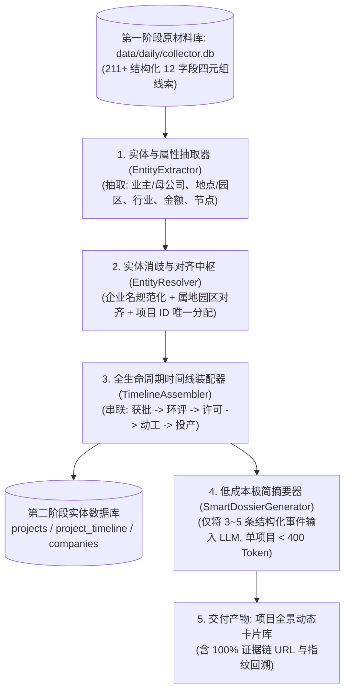

# 5392：越南信息收集项目·第二阶段：实体对齐、项目建档与低成本智能摘要工程计划

## 自启动提示词（供后续会话直接调用）

> 请阅读并严格执行本工作计划 `5392-2026-11-02-stage2-entity-alignment-and-project-profiling-plan.md`（引用码：5392，关联前序计划：8253、7163，基石报告：4178、9481）。
>
> **核心定位**：本计划正式开启本项目**“第二阶段（整理加工、实体对齐、项目全生命周期建档与低成本智能摘要）”**。在第一阶段已建立的 39 核心源常态化采集底盘与已落盘的 211 条高净值线索库之上，建立实体对齐中枢与项目档案库，将离散的四元组原材料（标题、摘要、时间、URL）熔炼为具备全生命周期时间线与证据闭环的“越南实体项目档案卡片”。
>
> **核心执行目标**：
> 1. **设计并固化实体与项目档案 Schema（实体模型）**：
>    - 定义四大核心数据结构：`Project`（实体项目档案）、`Enterprise`（母公司/在越法人实体）、`IndustrialPark`（承载工业园区）、`TimelineEvent`（生命周期关键节点事件）；
>    - 确立七大项目生命周期状态枚举：`IRC_APPROVED`（获批立项）、`SITE_CLEARANCE`（征地拆迁）、`EIA_CONSULTED`（环评公示）、`PERMIT_APPLIED`（排污许可）、`CONSTRUCTING`（开工建设）、`OPERATING`（试产投产）、`EXPANDING_EXIT`（增资扩产/退出变更）；
> 2. **构建实体抽取、对齐与时间线汇聚流水线（Pipeline）**：
>    - 规则与启发式抽取：从环评/排污（业主、地点、产能）、上市公司公告（代码、子公司、担保金额）、园区报道（跨国大厂、园区、投资额）中自动识别核心实体；
>    - 实体消歧与对齐（Entity Resolver）：基于“企业名称标准化 + 工业区/省份地理锚定 + 项目关键词”进行跨源线索归并；
>    - 全生命周期证据链串联：单项目串联多条动态事件，每条事件严格挂接 `source_id`、`fingerprint` 与官方原件 `url`，实现 100% 证据闭环、0 伪造幻觉；
> 3. **首批种子项目建档实跑与低成本摘要验证**：
>    - 基于本地 `data/daily/collector.db` 中的存量数据，首批自动识别并建立 10~15 个高价值标杆项目档案（如 LG Innotek 海防半导体新厂、共创草坪越南追加投资、金风科技越南担保开工、VinEnergo 莱州光伏电站、Vinausteel 兴安钢厂等）；
>    - 跑通单项目 <400 Token 的智能摘要卡片生成流水线，验证极低预算下的大模型摘要效果；
>    - 产出落地存储：`data/stage2/projects.json` 与 SQLite 实体扩展表。
>
> **执行原则与关键边界**：
> 1. 严格遵守证据链闭环：档案中所有项目进展、投资额、开工状态必须有且仅有对应信源 URL 佐证，绝不依靠大模型无中生有；
> 2. 严格遵守极低 Token 纪律：实体抽取与对齐主要由本地 Python 规则引擎完成，大模型仅用于最终 3~5 条事件的综合摘要，单项目消耗实控 <400 Token。

引用码：5392。关联计划：8253、7163。关联报告：4178、9481。日期：2026-11-02。

---

## 一、 第二阶段系统架构设计



---

## 二、 实体数据结构定义 (Schema)

### 1. 项目主档案 Schema (`Project`)
```json
{
  "project_id": "PRJ-VN-2026-0001",
  "project_name": "Nhà máy điện mặt trời Bản Chát 1",
  "project_name_cn": "本查 1 号光伏电站项目",
  "investor_name": "Công ty TNHH VinEnergo Bản Chát 1",
  "parent_company": "VinGroup / VinEnergo",
  "origin_country": "Vietnam",
  "province": "Lai Châu",
  "district_commune": "xã Mường Than, huyện Than Uyên",
  "industrial_park": null,
  "sector": "Renewable Energy (Solar)",
  "scale_capacity": "Điện mặt trời nổi",
  "current_stage": "EIA_CONSULTED",
  "created_at": "2026-11-02T17:30:00Z",
  "updated_at": "2026-11-02T17:30:00Z"
}
```

### 2. 项目动态时间线 Schema (`TimelineEvent`)
```json
{
  "event_id": "EVT-2026-0001",
  "project_id": "PRJ-VN-2026-0001",
  "event_date": "2026-10-20",
  "stage": "EIA_CONSULTED",
  "title": "Dự án: “Nhà máy điện mặt trời Bản Chát 1”",
  "summary": "Bộ TN&MT lấy ý kiến tham vấn ĐTM cho dự án điện mặt trời Bản Chát 1 tại huyện Than Uyên, tỉnh Lai Châu.",
  "source_id": "src-A09",
  "source_name": "Tham vấn ĐTM (EIA)",
  "raw_fingerprint": "3a8ab0094f32f555",
  "url": "https://thamvan.mae.gov.vn/XemChiTiet/XemChiTietDuAn?id=6415"
}
```

---

## 三、 执行步骤与阶段里程碑

### 步骤 1：构建实体抽取与解析模块 (`scripts/stage2/entity_pipeline.py`)
- 编写从环评 (`src-A09`)、排污 (`src-A10`)、信披 (`src-DISC-*`)、园区报道 (`src-B04`, `src-B01`)、外资英文 (`src-VN-FIN-06`) 等源中抽取企业、项目与属地的解析规则；
- 确立 SQLite 实体表存储结构（`projects`, `companies`, `project_timeline`）。

### 步骤 2：执行存量线索全量实体对齐与项目聚类
- 读取现有 211 条真实线索；
- 归并生成首批独立实体项目档案（目标生成 10~20 个独立重点项目）；
- 装配各项目的多节点时间线。

### 步骤 3：生成标准化“项目全生命周期动态档案卡片”
- 自动生成结构化 Markdown / JSON 档案专件；
- 验证证据链可追溯性与零幻觉保障。
