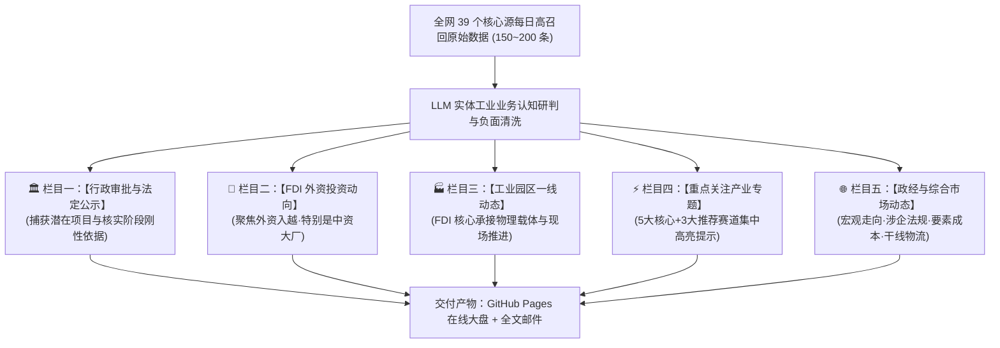

# 【5832】简报栏目体系与内容质量彻底重构工作计划

> **自启动提示词**：
> 本计划引用码为 `5832`，绝对路径为 `e:\geminiworks\vninfosrcab\5832-2026-11-04-briefing-taxonomy-and-content-reconstruction-plan.md`。
> **核心执行目标**：针对用户关于简报“内容”与“分类”的关键纠偏，彻底颠覆旧有分类体系，重构以“FDI 外资”、“工业园区”、“行政审批”、“重点产业专项”、“政经与综合市场”为支柱的全新正交架构，彻底清洗重复与无关杂质，升级编译引擎并重新发布 GitHub Pages 与邮件。
> **执行原则与边界**：严格坚守 100% 越南本土关联与海外强传导链条；全面消除任何同源重复；坚决剔除一切非工业类消费/公关/小微商贸杂讯；落款统一签署【太空建筑观察】越南组。新会话可直接读取本文件自主运转。

---

## 一、重构背景与用户核心纠偏

在对线上简报（`https://saga1394.github.io/vninfosrcab/`）进行全面 QA 审查后，结合用户的 6 条关键补充意见，明确当前简报存在的结构性缺陷与修正方向：

| 序号 | 用户核心意见 | 当前缺陷定位 | 修正与落地方案 |
| :--- | :--- | :--- | :--- |
| **1** | **P0 错误限制为“越南境内实体”，实应聚焦 FDI（特别是中资）** | 旧版 P0 收录了大量越南本土消费企业内部借款（PNJ）、总包商跨界买公关（Coteccons）等噪音，偏离出海主旨。 | **将 P0 重构为【FDI 外资投资动向】**，全景覆盖跨国/中资/台资大厂海外母公司决议、在越投资设厂、追加投资、合资并购与外迁动向。 |
| **2** | **工业园区作为承接 FDI 的主要载体，缺乏专门独立栏目** | 旧版工业区信息零散分散在客户、赛道和产业大盘中，缺乏承接载体主线。 | **设立独立的【工业园区一线动态】专栏**，聚合各省管委会与标杆工业地产商的供地、清表、开工、招商与现场调研。 |
| **3** | **政府动向分为新闻资讯类与行政审批类两部分** | 旧版政府动向混作一团，未能区分法规新闻与刚性审批。 | **结构双轨化**：行政审批归入刚性底册，新闻资讯归入综合政经。 |
| **4** | **行政审批是捕获潜在项目与核实项目进展的重要依据** | 旧版审批栏目充斥着小商贸变更与美国 SEC 基金报表，缺乏工业项目穿透力。 | **设立【行政审批与法定公示】独立专栏**，严选工业环评（MAE）、投资登记（IRC/ERC）、土地规划等潜在项目核查底册。 |
| **5** | **新闻资讯、整体市场方向、政经发展、综合产业合并为一个栏目** | 旧版划分过细且重叠，导致同一类宏观法规在不同分类间打架。 | **合并为【政经与综合市场动态】**，统摄投资法、税改、电力法、水电气油等要素成本与干线交通。 |
| **6** | **关心的具体产业或领域必须专门提示** | 重点赛道未做视觉突显，且存在与客户分类重复的问题。 | **设立【重点关注产业专题】集中高亮提示**，覆盖 5 大核心（半导体、数据中心、垃圾发电、储能电池、VinFast汽车）+ 3 大推荐赛道，每条全网唯一。 |

---

## 二、重构后的五大正交栏目体系（Taxonomy v3.0）

### 1. 🏛️ 栏目一：【行政审批与法定公示】（捕获潜在项目与核实阶段刚性依据）
- **核心定位**：捕获前期潜在项目线索、核实验证实体项目真实推进阶段（立项->环评->拿地->开工）的最硬核抓手。
- **收录范围**：
  - 重大工业项目的环境影响评估（MAE/DTM）受理、审查与批复；
  - 外商投资登记证书（IRC / ERC）核准、增资与变更公告；
  - 工业用地规划审批、征地批复、施工规划许可证；
  - 重大涉企监管稽查、违规项目清理终止决定。
- **负面排除**：不知名小微个体商贸登记变更、境外证券基金报表、微额行政合规处罚。

### 2. 🎯 栏目二：【FDI 外资投资动向】（聚焦外资入越·特别是中资大厂）
- **核心定位**：跨国企业、特别是中国企业（大陆及港澳台）以及全球制造业外资进入越南的一手动态。
- **收录范围**：
  - 中资/跨国大厂海外母公司对越重大投资决议、意向协议与境外审批；
  - 在越独资/合资设厂、追加产线投资、增资扩建、资产并购、清盘外迁；
  - 核心外资大厂配套供应链的搬迁与落地。
- **负面排除**：越南本土消费零售贷款、总包商跨界买公关公司、小微商贸财报。

### 3. 🏭 栏目三：【工业园区一线动态】（FDI 核心承接物理载体与现场推进）
- **核心定位**：各省工业区管委会与标杆工业地产商（VSIP、BW、Deep C、Amata、Viglacera 等）的一线现场进展。
- **收录范围**：
  - 工业园区新建、扩容、规划批复与奠基开工；
  - 园区土地清表、征地拆迁安置补偿（解决供地卡点）；
  - 园区现场招商引资签约、入园项目名单公示；
  - 园区水电气排污等基础设施配套工程建设与领导现场调度。

### 4. ⚡ 栏目四：【重点关注产业专题】（5大核心+3大推荐赛道集中高亮提示）
- **核心定位**：用户明确点名的 5 大核心产业 + 3 大战略赛道动态，**专区集中高亮提示**！
- **赛道清单**：
  1. 💡 半导体与先进封装
  2. 💡 数据中心与云算力
  3. 💡 垃圾发电与环保固废
  4. 💡 储能与动力电池
  5. 💡 VinFast 与新能源汽车供应链
  6. 💡 高标仓储与智慧冷链物流
  7. 💡 工业绿电直供（DPPA）与清洁能源
  8. 💡 精密机械与自动化装备
- **收录与呈现规则**：**全网唯一归口，绝不与 FDI 或园区栏目跨类重复**。若当日无该赛道增量，客观标示“本日平稳/暂无新增重磅”，绝不硬凑充数。

### 5. 🌐 栏目五：【政经与综合市场动态】（宏观走向·涉企法规·要素成本·干线物流）
- **核心定位**：政府宏观政经动向、部委政策法规宣导、水电气能源与物流要素成本、大盘市场综合体温。
- **收录范围**：
  - 《投资法》、《税收法》（如全球最低税细则）、《电力法》等涉企核心法律修改与落地；
  - 工业用电、燃油特别消费税、中水等生产要素价格变动；
  - 海铁联运、港口集疏运、干线物流网络基础设施；
  - 宏观营商环境、外贸承压与行业协会经营水温预警。
- **负面排除**：展望至 2045 年的远景空泛通稿、飞机机队 20 年预测等营销通稿。

---

## 三、清洗与重构任务清单

1. **底层数据重清洗（立即执行）**：
   - 彻底删除 3 组跨分类重复条目；
   - 彻底剔除 Coteccons 投资公关公司、PNJ 借款、先锋塑料教育用地改商住、SMC 钢贸商清欠、国威商贸普通工商变更、美国 SEC 基金报表、空客 20 年预测等 7 条噪音；
   - 将现有高质量 30+ 条资讯按照新五大栏目重新划归，每条全网唯一。
2. **生成脚本与页面重构（`generate_html_report.py`）**：
   - 重构 HTML 结构：顶部导航、KPI 统计条、Tab 切换完整映射五大新栏目；
   - 重点关注产业专题配备醒目的高亮徽章与赛道分类标识；
   - 重写所有条目的【看点】，直击业务与实体落地影响，彻底剔除元语言八股文。
3. **交付产物部署与推送**：
   - 重新编译并发布至 `docs/index.html`（GitHub Pages）；
   - 更新并发送最新版全文无截断内参邮件至用户邮箱。
