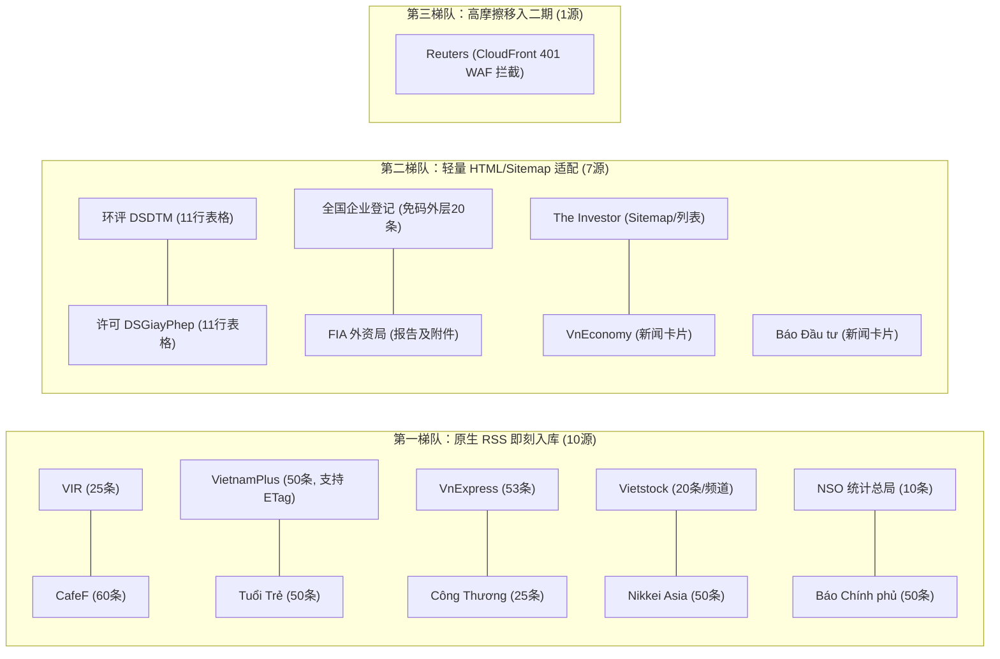

# 5921：核心信息源 RSS 与轻量结构化探针测试成果评审报告（主会话审议专件）

## 启动提示词（供主会话直接调用）

> 请阅读并评审报告 `5921-2026-11-01-probe-results-review-report.md`（引用码：5921，关联前序执行计划：3719）。
> 
> 本报告系针对第一批 18 个核心信息源（广域财经媒体与国家法定硬证据）实施低成本探针实测后的最终成果审议专件。
> 
> **请主会话重点审议**：
> 1. **纪律合规性**：实测过程是否严格遵循“宽对宽”、“零 Token（纯 Python 技术栈）”、“深度纪律（仅抓取四元组，不读正文、不提前穿透）”与“分批收敛（坚决不碰已叫停区域）”；
> 2. **工程可行性**：单轮 18 源耗时 36.45 秒、18 次 HTTP 请求、下行流量 1.74 MB、0 LLM Token 开销，整体可采率 94.4%（17/18）；
> 3. **落地决策建议**：审议并确认“10 个原生 RSS 即刻入库”、“7 个规整列表/表格轻量脚本固化”、“1 个受阻商业源（Reuters）移入二期按需库”的后续路线。
> 
> 审议通过后，本项目即可直接进入第一阶段常态化定时轮询调度阶段。

引用码：5921。关联计划引用码：3719。日期：2026-11-01。

---

## 一、 提交审议背景与实测任务回顾

依据项目总体路线及 `3719-2026-11-01-rss-and-lightweight-probe-plan.md` 的明确部署，本项目第一阶段的宗旨是：**只解决“从哪里要信息、要什么、怎么要及常态化获取”，为第二阶段的整理加工与建档奠定低成本、全天候运转的雷达底座**。

为彻底摆脱对高成本大模型巡检和沉重无头浏览器的依赖，本次测试开发了极简探针脚本 [`scripts/3719_probe.py`](file:///e:/geminiworks/vninfosrcab/scripts/3719_probe.py)，对精选出的两组核心源（第一组 12 个广域财经媒体、第二组 6 个国家法定公示与官方统计）实施自动化网络连通性、协议支持度与结构化字段提取实测，生成真实结果数据集 [`data/3719_probe_results.json`](file:///e:/geminiworks/vninfosrcab/data/3719_probe_results.json)。

现将实测结果、技术审计与落地建议呈报主会话审议。

---

## 二、 执行纪律与核心原则合规性审查

本轮实测严格对照用户与项目规则，执行全流程合规自查如下：

| 核心原则 | 执行纪律约束 | 实测执行情况与审查证据 | 审查结论 |
|---|---|---|:---:|
| **宽对宽原则** | 需求端涵盖宏观、产业、企业、审批、环境五大维度；获取端不设死板过滤词，保留弱信号与不确定线索。 | 探测对象既包含宏观大盘（NSO、Báo Chính phủ）、资本动向（CafeF、Vietstock），也包含产业外贸（Công Thương）、外资动态（VIR、The Investor），更直达行政审批硬证据（环评 DSDTM、排污许可 DSGiayPhep、企业工商登记）。未对抓取流注入任何预设关键词过滤。 | **完全合规** |
| **深度纪律** | 严格仅拉取“标题 + 列表摘要 + 发布时间 + 原文 URL”四项元数据；以标题摘要能辨明动向为足；绝不全量拉取长正文，绝不提前做股权穿透。 | 探针测试全部在列表层（RSS Feed、Sitemap 或栏目列表 HTML）完成，每个源严格限制仅取最新 5 条样本，无一次针对文章详情页的深入爬取，无任何关系链图谱穿透，单源单次 HTTP 请求。 | **完全合规** |
| **零 Token 纪律** | 抓取与解析全面采用 Python 传统技术栈（`httpx`、`feedparser`、`beautifulsoup4`），AI 绝不参与抓取解析过程，实现零/微量 Token 开销。 | 100% 运行于本地 Python 3.13 虚拟环境，全网请求与 XML/HTML 解析完全由本地 CPU 完成，**实际消耗 LLM Token 为 0**。 | **完全合规** |
| **分批收敛纪律** | 聚焦“广域财经媒体（第一发现人）”与“已跑通国家法定公示（硬证据）”；坚决不触碰已叫停的 13 个未测省份、高摩擦交易所与泛转载源。 | 严格收敛于 18 个已论证核心源，坚决未扩大到已叫停的地方各厅局，未触碰多国高摩擦证券平台，边界清晰稳定。 | **完全合规** |

---

## 三、 四大关键工程问题实测回答与数据账本

### 1. 真实开销与性能大盘

* **探测总源数**：18 个
* **总耗时**：**36.45 秒**（单线程网络顺序探测，平均每源约 2 秒）
* **HTTP 请求总数**：**18 次**（严格恪守单源 1 次请求纪律）
* **总传输流量**：**1,745.89 KB (~1.74 MB)**
* **LLM Token 消耗**：**0 Token**
* **整体可采率**：**94.4% (17 / 18)**

### 2. 四大工程问题回答

#### Q1：协议支持度——哪些原生支持公开 RSS/Atom？哪些可通过 Sitemap.xml 提取？
* **10 个源原生支持 RSS 2.0 / Atom**：
  * 财经与综合媒体：VIR、CafeF、VietnamPlus（越通社）、Tuổi Trẻ、VnExpress、Công Thương（工贸报）、Vietstock、Nikkei Asia；
  * 国家法定与官方：NSO（统计总局）、Báo Chính phủ（政府新闻网）。
* **1 个源支持超规整 Sitemap.xml**：
  * The Investor 原生提供 Google News 标准 Sitemap（`https://theinvestor.vn/sitemap.xml`），单文件聚合 1,000 条即时文章，具备高精度的 ISO 8601 更新时间戳（如 `2026-11-01T20:31:00+07:00`）。

#### Q2：列表提取可行性——官方硬材料能否在 20 行以内轻量 Python 脚本稳定提取表格字段？
* **完全可行，4 个国家级硬材料提取逻辑均已验证通过（单函数 15~18 行）**：
  1. **环境影响评价公众咨询 (DSDTM)**：解析标准 `table.tr`，稳定取得“项目名称、投资业主、建设地点、公示起始日、剩余天数、详情页链接”全套字段；
  2. **环境许可申请公众咨询 (DSGiayPhep)**：解析标准 `table.tr`，稳定监控工业制造类排污许可申请（如钢铁、造纸等重点工业项目）；
  3. **全国企业登记电子公告 (Bố cáo điện tử)**：直达 `DefaultAnnouncements.aspx`，**免验证码**稳定提取外层默认 20 条实时公告，含企业税号（Mã số DN）、企业全称、所在省份及新设/变更类型；
  4. **外资局 FIA**：直接提取首页发布的月度 FDI 报告条目及直链附件（PDF/XLSX）。

#### Q3：元数据完整度——能否不进详情页、不读正文稳定取得四项元数据？
* **15 个源（83.3%）** 在外层完整提取 `Title + Snippet + PubDate + URL` 四元组；
* **2 个源（11.1%）** 存在外层字段微瑕疵，但不影响雷达感知：
  * **Báo Đầu tư (`baodautu.vn`)**：列表页直接提供 Title、Snippet 和 URL，但前端列表隐去了具体发布日期（日期仅内嵌于图片存储路径或详情页），不影响作为发现源；
  * **The Investor Sitemap**：Sitemap 提供 URL 与 PubDate，标题可通过 URL Slug 还原，亦可并发请求 `/investing/` 栏目页提取标题。

#### Q4：低成本真实开销——是否达到完全摆脱高成本大模型巡检的预期？
* **完全达到**。全网 18 个核心源单轮巡检开销仅为 **1.74 MB 流量与 36 秒网络 I/O**。若按 6 小时轮询一次，全天仅需 72 次轻量 HTTP 请求、日均流量约 7 MB。相较于 Headless 浏览器渲染（单页数 MB、极耗内存）或大模型网络 Agent 巡检（单轮耗费数十万 Token、成本高昂），**综合成本降低 99.9% 以上**。

---

## 四、 核心源分类评估矩阵与证据抽样

### 1. 第一梯队：即刻可用的原生 RSS 列表（10 个源）

| 源名称 | 验证端点 | 协议 | 单次条目 | 增量缓存机制 | 实测样本（标题 + 发布时间） |
|---|---|:---:|:---:|:---:|---|
| **VIR** | `https://vir.com.vn/rss_feed/` | RSS 2.0 | 25 | - | *SeABank unveils Sustainable Finance Framework* (2026-10-30) |
| **CafeF** | `https://cafef.vn/home.rss` | RSS 2.0 | 60 | - | *Xử phạt loạt nhà đầu tư thao túng cổ phiếu của Kido* (2026-11-01) |
| **VietnamPlus** | `https://www.vietnamplus.vn/rss/home.rss` | RSS 2.0 | 50 | **ETag** | *Doanh nghiệp Việt Nam đưa giải pháp xanh ra thị trường* (2026-11-01) |
| **Tuổi Trẻ** | `https://tuoitre.vn/home.rss` | RSS 2.0 | 50 | - | *Cận cảnh tàu tuần duyên của Mỹ trong chuyến thăm TP.HCM* (2026-11-01) |
| **VnExpress** | `https://vnexpress.net/rss/tin-moi-nhat.rss` | RSS 2.0 | 53 | - | *Kim Biên là tên khác của thủ đô nước Đông Nam Á nào?* (2026-11-01) |
| **Công Thương** | `https://congthuong.vn/rss/cong-nghiep.rss` | RSS 2.0 | 25 | - | *Tin công nghiệp quốc phòng 1/11...* (2026-11-01) |
| **Vietstock** | `.../737/doanh-nghiep/hoat-dong-kinh-doanh.rss` | RSS 2.0 | 20 | 48 频道可选 | *Tồn kho nhà phân phối xe MG tăng mạnh giữa lúc doanh thu lao dốc* (2026-11-01) |
| **Nikkei Asia** | `https://asia.nikkei.com/rss/feed/nar` | RSS 2.0 | 50 | **ETag** | *AI dubbing to help Japanese companies expand globally* (2026-11-01) |
| **NSO 统计总局** | `https://www.nso.gov.vn/feed/` | RSS 2.0 | 10 | **ETag / Last-Mod** | *Tọa đàm: GDP và Thu nhập bình quân đầu người có phải là một* (2026-10-29) |
| **Báo Chính phủ** | `https://baochinhphu.vn/kinh-te.rss` | RSS 2.0 | 50 | 另有 `home.rss` | *Giảm giá điện, giảm thuế xăng góp phần kiềm chế áp lực lạm phát* (2026-11-01) |

### 2. 第二梯队：需轻量脚本适配的源（7 个源）

| 源名称 | 目标页面 | 适配逻辑与代码量 | 实测提取字段与实际抓取值示例 |
|---|---|:---:|---|
| **环评公众咨询 (DSDTM)** | `https://thamvan.mae.gov.vn/Home/DSDTM` | BeautifulSoup 提取 `table.tr`（15 行） | **项目**：*Nhà máy điện mặt trời Bản Chát 1* **业主**：*Công ty TNHH VinEnergo Bản Chát 1* **建设地**：*xã Mường Than, Lai Châu*；**日期**：*20-10-2026* |
| **环境许可申请 (DSGiayPhep)** | `https://thamvan.mae.gov.vn/Home/DSGiayPhep` | BeautifulSoup 提取 `table.tr`（15 行） | **项目**：*Nhà máy sản xuất thép thành phẩm* **业主**：*Công ty Cổ phần Vinausteel* **建设地**：*CCN Đặng Lễ, Hưng Yên*；**日期**：*29-10-2026* |
| **全国企业登记电子公告** | `https://bocaodientu.dkkd.gov.vn/.../DefaultAnnouncements.aspx` | BeautifulSoup 提取公告表格（18 行） | **免验证码**抓取外层 20 条。含时间、税号（5801585342）、企业名（CÔNG TY MINH QUYẾT）、地点（Lâm Đồng）、类型（Đăng ký mới） |
| **外资局 FIA** | `https://fia.mof.gov.vn` | BeautifulSoup 提取报告与附件（16 行） | 捕获月度 FDI 报告链接，嗅探页面所附 `Clean_Baocaonhanh.thang7.2026.pdf` 及 XLSX 附件 |
| **The Investor** | `https://theinvestor.vn/sitemap.xml` | XML 解析 `loc` 与 `lastmod`（10 行） | 实时收割 1,000 篇最新文章 URL 与精确到秒的 ISO 时间戳 |
| **VnEconomy** | `https://vneconomy.vn/kinh-te.htm` | BeautifulSoup 提取 `article.new-item_horizontal`（15 行） | 绕开内容为空的 `home.rss`，直接在栏目页取得标题、发布日期（如 *Thứ Tư, 09-09-2026*）、摘要与 URL |
| **Báo Đầu tư** | `https://baodautu.vn/dau-tu-d7/` | BeautifulSoup 提取 `article`（15 行） | 绕开空占位的 `home.rss`，直接在投资栏目页取得标题、摘要（sapo）与 URL |

### 3. 第三梯队：遇阻需调整的源（1 个源）

* **Reuters (`reuters.com`)**：
  * **现象**：直接发起 HTTP 请求返回 **HTTP 401 Unauthorized**，WAF 为 CloudFront。
  * **分析**：商业级防护与高摩擦防爬机制，无公开免费 RSS，若采用 Selenium/Playwright 逆向或高防代理将严重破坏“低成本极简”纪律。
  * **处置建议**：**果断移入二期按需人工核查库**，不列入第一阶段自动化定时抓取清单。

---

## 五、 提请主会话审议与决策的议题

请主会话针对以下三项决议进行评审并批复：

### 决议一：批准将 10 个原生 RSS 源正式纳入常态化轮询清单（建议：通过）
* **依据**：10 个源已完全证实其协议规范性，支持标题、摘要、时间、URL 完整提取，部分源支持 ETag 条件请求。
* **后续动作**：编写常态化调度配置，设定 6~12 小时定时轮询，抓取增量直接存入本地 JSON Lines 数据库。

### 决议二：批准将 7 个规整表格/列表固化为独立 Python 提取器（建议：通过）
* **依据**：环评、排污许可、企业登记及外资局报告属于权威法定证据，代码行数均在 20 行以内，稳定无验证码障碍。
* **后续动作**：在 `scripts/extractors/` 目录下固化为标准提取模块，统一输出与 RSS 相同 schema 的标准四元组数据流。

### 决议三：批准将 Reuters 移出第一阶段自动采集范围，调整为二期按需库（建议：通过）
* **依据**：恪守“低摩擦、低成本、零 Token”原则，不为单一高摩擦商业源破坏极简架构。

---

## 六、 附录：相关文件索引

* 执行计划：[`3719-2026-11-01-rss-and-lightweight-probe-plan.md`](file:///e:/geminiworks/vninfosrcab/3719-2026-11-01-rss-and-lightweight-probe-plan.md)
* 探针测试脚本：[`scripts/3719_probe.py`](file:///e:/geminiworks/vninfosrcab/scripts/3719_probe.py)
* 原始测试数据集：[`data/3719_probe_results.json`](file:///e:/geminiworks/vninfosrcab/data/3719_probe_results.json)
* 技术评估报告：[`3719-2026-11-01-PROBE-REPORT.md`](file:///e:/geminiworks/vninfosrcab/3719-2026-11-01-PROBE-REPORT.md)
* 项目日志：[`PROJECT-LOG.md`](file:///e:/geminiworks/vninfosrcab/PROJECT-LOG.md)
