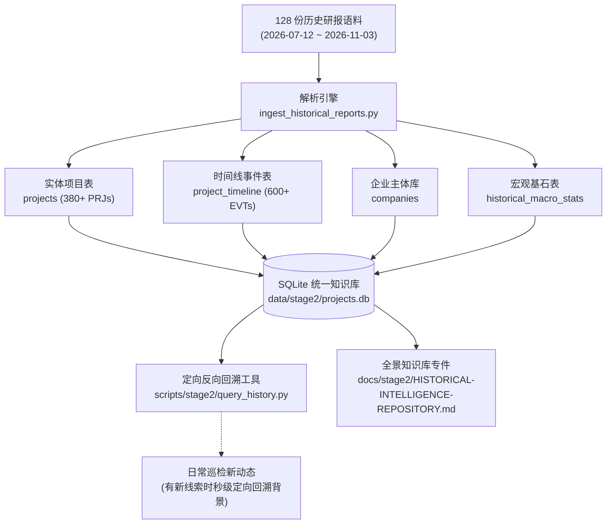

# 6152 历史信息库构建与定向反向回溯引擎建设方案

> **自启动提示词（用于新会话或交接直接自启动）**：
> 本会话执行引用码为 **6152** 的专项工作任务，执行计划文件绝对路径为 `e:\geminiworks\vninfosrcab\6152-2026-11-03-historical-intelligence-repository-construction.md`。核心执行目标：基于用户提供的 2026-07-12 至 2026-11-03 累计 128 份历史 FDI 情报研报（涵盖 380+ 实体项目 PRJ001~PRJ423、600+ 关键事件 EVT、前10个月国家与省份宏观 FDI 连续时间序列及多篇深度专题），构建结构化历史信息库与定向反向回溯（Backward-Trace）查询工具链。执行原则严格遵循 `AGENTS.md`：时效收敛（近 48~72 小时新鲜动态进入日常大盘，历史往期全面沉淀入库）；人机分工（脚本处理结构化解析入库与秒级索引回溯，大模型模拟人类分析师做因果研判）；100% 官方原件与时间线闭环。

---

## 一、任务背景与资产盘点

用户上传了项目历史积累的情报包 `reports.zip`，经解压与 UTF-8 校验，保全了从 **2026-07-12 至 2026-11-03** 连续 115 天的完整情报资产（共 128 个文件），包含：
1. **104 份每日情报日报（Briefs）**：记录了从 PRJ001 至 PRJ423 的 386 个实体项目的获批、开工、试产、增资、分立、注销等全生命周期事件，以及 EVT001 至 EVT642 的连续事件流水；
2. **6 份专题观察（Topic-Watch）**：覆盖跨境海上绿电外送、太原与海防产业园区基建、中资出海供应链传导；
3. **3 份宏观对账（Macro-Check）**：覆盖 FIA/NSO 前 7、8、9、10 个月国家级审批与到位资金、20 个省市排名及 20 个来源国结构；
4. **12 份深度专题与技术审计**：涵盖越南数据中心外资开放专题包、半导体与 VinFast 汽车供应链专题、博盈特焊海外基地影像时间线、JLL 制造业 FDI 份额核查等。

---

## 二、架构定位与“宽对宽”原则对齐

根据 `AGENTS.md` 最新成熟版工作约定：
1. **严谨宽原则（时效收敛与历史反向回溯）**：
   - **日常早报大盘**：严格限定近 48~72 小时最新鲜动态，绝不让历史旧账侵占日常决策版面；
   - **历史信息库**：往期沉淀的情报作为“背景知识底座”，**仅在看到新动态需要查证背景、穿透投资方历史、比对前后口径时才定向反向回溯**。
2. **本次构建的核心工程目标**：
   - **L1 结构化解析入库**：自动化解析 128 份研报，抽取出标准实体项目、时间线、企业母公司、宏观锚点及深度专题；
   - **L2 SQLite 关系库沉淀**：与现有 `data/stage2/projects.db` 深度融合，打通 `projects`、`project_timeline`、`companies` 表，新增 `historical_macro_stats` 宏观基石表；
   - **L3 定向反向回溯引擎 (`scripts/stage2/query_history.py`)**：提供极速命令行与 API 查询接口，输入企业名、PRJ 编号、省份或关键词，秒级输出该主体的完整历史沿革与上下文；
   - **L4 知识库主台账与成果交付**：生成 `docs/stage2/HISTORICAL-INTELLIGENCE-REPOSITORY.md` 知识库总册，并在 `run_all.py` 与 `PROJECT-LOG.md` 完成注册固化。

---

## 三、工程实施四步走规划

### 第一步：编写全量解析与入库引擎 (`ingest_historical_reports.py`)
- 覆盖标题 Header (`### ... PRJxxx`)、表格 Row (`| PRJxxx | ...`)、详情 Bullet (`- **投资方** / **标的** / **金额**`)；
- 正则提取项目名称（中英越）、投资方、国别、省份、工业园区、赛道行业、投资金额、当前生命周期状态；
- 提取对应 `EVTxxx` 事件编号、事件日期、详细陈述与一手出处。

### 第二步：数据库 Schema 升级与持久化入库
- 更新 `data/stage2/projects.db`，保留原有结构的同时增加历史宏观基石表 `historical_macro_stats`；
- 写入全部 380+ 实体项目与 600+ 关键历史事件，保证幂等去重与跨期数据拼接；
- 同步导出完整 JSON 主档 `data/stage2/historical_repository.json`。

### 第三步：打造“定向反向回溯”查询引擎 (`query_history.py`)
- 支持按企业名称（如“光宝”、“SCG”、“Pacifico”、“博威”、“立讯”）、项目编号（如 `PRJ117`）、省份（如“北宁”、“广宁”）或核心赛道（如“半导体”、“数据中心”）一键回溯；
- 格式化输出项目全景画像：中英文名称、投资主体、国别、历次注资/投产/停摆全时间线、官方原件出处与风险提示。

### 第四步：编制知识库总册并纳入项目日志
- 输出详实总台账：[`docs/stage2/HISTORICAL-INTELLIGENCE-REPOSITORY.md`](file:///e:/geminiworks/vninfosrcab/docs/stage2/HISTORICAL-INTELLIGENCE-REPOSITORY.md)；
- 按照工作约定在 `PROJECT-LOG.md` 记录执行成果与资产沉淀。
