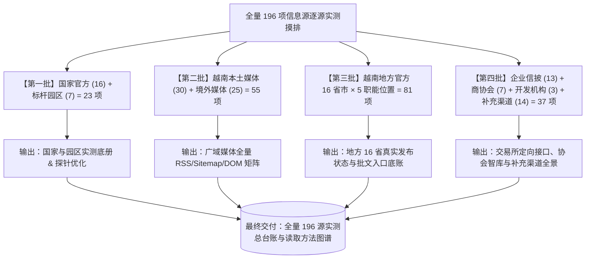

# 7163：全量 196 个信息源分组实测摸排与读取方法验证总计划

## 启动提示词

> 请阅读并执行计划 `7163-2026-11-02-full-source-inventory-and-verification-plan.md`（引用码：7163）。
> 
> **本任务的核心目标**：对调整目录中的全部 196 个信息源进行**100% 实打实的逐源摸排与技术验证**，坚决杜绝任何未经检验的经验推测或纸面假定。
> 
> **执行核心原则**：
> 1. **全量实测、不留死角**：全量 196 项按九大类必须逐一实际访问、实际提取、实际验证其可读性与真实供给。不预先砍源，不提前划分一二期，以客观事实作为唯一评价依据。
> 2. **真实证据保全**：每个源的摸排结果必须记录：真实 HTTP 响应状态、反爬拦截情况（WAF/验证码）、验证通过的具体读取方法（原生 RSS / 规整表格 / DOM 选择器 / API / PDF 直链）、实际提取到的样本数据（真实标题、日期、URL、摘要）以及该源当前的实际供给边界。
> 3. **分批迭代、过程固化**：分 4 个批次推进（国家与园区 23 源 $\rightarrow$ 越媒与外媒 55 源 $\rightarrow$ 地方 16 省 81 职能位置 $\rightarrow$ 企业信披与机构 37 源）。每批次均须沉淀独立的过程报告与原始数据，并在批次推进中持续迭代优化网络探针与解析方法。
> 4. **低成本零 Token 纪律**：网络探测与页面解析 100% 采用本地 Python 标准库与轻量解析器（`httpx`, `feedparser`, `beautifulsoup4` 等），不调用大模型进行爬取，保持零/微量算力开销。
> 
> 执行前先核对总台账与当前批次进度，从未完成处接续执行。

引用码：7163。日期：2026-11-02。

---

## 一、 摸排背景与核心宗旨

根据用户明确指示：**必须彻底告别纸面推演与经验推断，对全量近 200 个信息源进行实实在在的全面摸底**。
本计划旨在构建一套客观、真实、可复查的《全量信息源资产与读取方法总台账》，明确回答每一个源：
1. **它到底能不能读？**（网络通断、反爬机制、验证码障碍、更新频次）；
2. **用什么方法读最轻量有效？**（原生 RSS、XML Sitemap、HTML 表格、特定 DOM 卡片、API 接口、PDF/XLSX 原件）；
3. **它实际能给出什么材料？**（根据真实抓取到的条目，判定其对 D01-D11 需求的真实支撑边界，不凭空赋予能力）。

---

## 二、 摸排四批次推进矩阵（全量 196 项）

全量 196 项按业务相关度与技术类型划分为 4 个推进批次：

### 批次划分与实测重点：

| 批次 | 涵盖类别 | 项数 | 核心实测任务与技术要点 |
|:---:|---|:---:|---|
| **第一批** | **国家级官方 (16) + 标杆园区 (7)** | **23** | • 实测验证 MAE 环评/许可表格、企业登记免码列表、NSO 表单导出、FIA 原表下载； • 实测 7 大工业园区官网新闻与租户名录的可抓取度。 |
| **第二批** | **越南媒体 (30) + 境外媒体 (25)** | **55** | • 全面嗅探 55 家新闻媒体的原生 RSS/Atom 端点与 Google News Sitemap； • 无 RSS 的媒体实测其投资/财经频道的 DOM 选择器；记录 WAF 拦截实况。 |
| **第三批** | **越南地方官方 (16 省市 × 5 类职能)** | **81** | • **重点攻坚区**：实测 16 个重点省市的政府门户、工业区管委会、财政厅、建设厅、农业环境厅真实网址； • 摸清哪些是现行有效入口、哪些是空壳、哪些有公开批文。 |
| **第四批** | **企业信披 (13) + 商协会 (7) + 国际开发 (3) + 补充渠道 (14)** | **37** | • 实测 10 大证券交易所的关键词检索与反爬机制（巨潮、MOPS、HKEX、SGX、DART 等）； • 摸排 7 个商协会的调研简报与 3 个开发机构的项目数据库。 |
| **合计** | **全部九大类别** | **196** | **100% 逐源实测覆盖，不留任何推测空白** |

---

## 三、 单源摸排的标准操作规范（SOP）

每个源必须严格按照以下标准化步骤进行探测与记录：

1. **Step 1: 基础连通性与协议探测**
   * 发送轻量 HTTP 请求，获取并记录：HTTP Status、响应头 `Content-Type`、`Server`、`ETag`、`Last-Modified`；
   * 记录是否存在 SSL 证书异常、重定向链、Cloudflare/CloudFront WAF 拦截或图形验证码。
2. **Step 2: 读取方法实测（按优先级尝试）**
   * **方法 A（原生 Feed）**：嗅探 `/rss`, `/feed`, HTML `<link rel="alternate" type="application/rss+xml">`，用 `feedparser` 尝试解析；
   * **方法 B（Sitemap）**：检查 `robots.txt` 和 `/sitemap.xml`，提取最新文章 URL 与时间戳；
   * **方法 C（规整表格/列表）**：针对政务公开、审批、登记页面，用 `BeautifulSoup` 定向定位 `table.tr` 或 `article` 卡片；
   * **方法 D（接口/API/文件直链）**：探测是否有公开的 JSON/XLSX/PDF 接口或下载清单。
3. **Step 3: 提取样本与数据落地**
   * 必须真实提取最新 3~5 条记录的“四元组”：**标题 (Title)、发布时间 (PubDate)、摘要 (Snippet)、原文链接 (URL)**；
   * 记录提取的准确度，标明哪些字段存在缺失或格式特殊。
4. **Step 4: 供给能力实事求是评价**
   * 依据真实抽样到的内容，判定其能够支撑五大需求中的哪一项（D01-D11）；
   * 记录该源的真实局限（如：仅有标题无摘要、时效滞后、仅有中文转载、有内网跳转等），绝不夸大能力。

---

## 四、 过程文档与数据资产沉淀规范

每次批次执行必须生成并保存对应的过程资产，统一存放于 `inventory/` 体系下：

1. **执行脚本**：`scripts/inventory/probe_batch_{1,2,3,4}.py`（保留完整请求头、重试与解析逻辑）；
2. **原始数据集**：`data/inventory/batch_{1,2,3,4}_raw_results.json`（保存每个源的完整请求元数据与样本 JSON）；
3. **批次过程报告**：`docs/inventory/7163-batch-{1,2,3,4}-inventory-report.md`（详细列明每个源的实测细节、成功提取项、阻断原因与方法优化点）；
4. **动态总台账**：维护 `docs/inventory/FULL-SOURCE-INVENTORY-LEDGER.md`，汇总 196 项的实时摸排状态（已验证可用 / 需脚本适配 / 反爬阻断 / 空壳待查）。

---

## 五、 批次迭代机制

在推进过程中严格执行“小步快跑、持续改进”：
* 第一批国家与园区摸排完成后，总结政务表格与园区新闻的共性结构，提炼通用的解析模块；
* 第二批媒体摸排完成后，优化 RSS 嗅探指纹库与应对常见新闻 CMS 的选择器；
* 第三批地方厅局摸排时，复用针对越南政务统一平台的批量探针脚本，提高大批量测试效率；
* 第四批交易所摸排时，专项突破各平台的反爬与查询接口规范。
