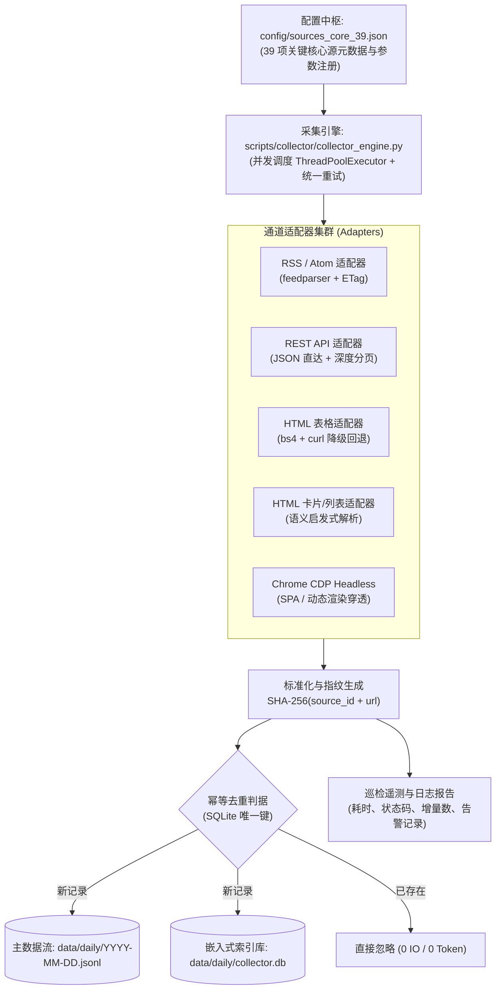

# 8253：越南信息收集项目·常态化定时巡检框架装配与试运行工作计划

## 自启动提示词（供后续会话直接调用）

> 请阅读并严格执行本工作计划 `8253-2026-11-02-routine-inspection-framework-and-trial-run.md`（引用码：8253，关联基石报告：4178、9481，基础计划：7163）。
>
> **核心定位**：本计划负责落地本项目“路径 A：常态化定时巡检工程装配与首轮全景试运行”，将前序摸排验证的 39 个“二八定律”关键核心信息源（涵盖母公司信披、国家刚性审批、财经雷达、标杆园区、核心省市、行业协会六大集群）从零散探针装配为高内聚、模块化、可无人值守的生产级采集框架，并执行首轮完整试运行，查验数据成果与潜在工程问题。
>
> **核心执行目标**：
> 1. **架构装配（零 Token 底盘）**：
>    - 配置层：统一建立 `config/sources_core_39.json`，集中管理 39 个核心源的唯一 ID、名称、通道类型、请求端点、分类、省份、业务维度标签及特定适配参数；
>    - 引擎层：在 `scripts/collector/` 下构建模块化采集引擎 `collector_engine.py`，支持 RSS/Atom、REST API、HTML 规整表格、HTML 语义卡片、Chrome CDP Headless 五大通道适配器；
>    - 调度与并发：采用可控并发线程池（ThreadPoolExecutor），实现全网多源秒级并行获取，兼顾采集吞吐与目标服务器友好度；
>    - 双轨沉淀与幂等去重：严格执行单条 12 字段标准 Schema，基于 `SHA-256(source_id + url)` 计算指纹，增量写入主数据流 `data/daily/YYYY-MM-DD.jsonl` 与嵌入式索引库 `data/daily/collector.db`（`INSERT OR IGNORE`）；
> 2. **首轮试运行与全景体检**：
>    - 完整触发 39 个核心信息源的端到端并发试运行；
>    - 统计大盘指标：总耗时、网络流量、有效连通率、成功采集源数、提取记录总数、增量入库记录数；
>    - 成果盘点：分集群抽样核验各源真实产出，评估对出海动向（D01）、项目审批动工（D02）、供应链转移（D05）、经营环境（D07）及宏观（D11）的实际支撑力；
>    - 问题排查：记录网络超时、SSL 降级、结构解析畸变或无增量等工程异常，给出针对性加固与处置对策。
>
> **执行原则与关键边界**：
> 1. 严格遵守第一阶段边界：仅抓取“标题 + 列表摘要 + 发布时间 + URL”四项元数据与基础索引，绝不在此阶段消耗 LLM Token 爬取长文网页；
> 2. 严格遵循“宽对宽”原则与幂等性要求，确保系统多次运行不产生脏数据与重复记录。

引用码：8253。关联计划：7163。关联报告：4178、9481。日期：2026-11-02。

---

## 一、 架构设计与工程蓝图

---

## 二、 详细执行路线图

### 阶段一：配置中心与适配器装配
1. 创建 `config/sources_core_39.json`，结构化沉淀 39 个核心源的全部参数；
2. 构建 `scripts/collector/collector_engine.py`，实现多通道协议路由与并发线程池调度；
3. 打通 SQLite 与 JSONL 双轨写入通道，确保数据库事务与文件流并发安全。

### 阶段二：首轮试运行与全景数据采集
1. 执行首轮 39 源真实网络抓取；
2. 记录全流程运行耗时、网络流量与各源 HTTP 响应；
3. 输出入库统计与指纹去重成效。

### 阶段三：成果分析与问题诊断
1. **收集到的业务成果**：展示六大集群（母公司、审批、媒体、园区、省市、协会）实际产出的高质量线索样本；
2. **碰到的工程问题与对策**：详细记录试运行中出现的连接异常、超时、内容变异等现象，给出加固方案；
3. 形成执行总结并更新项目日志 [PROJECT-LOG.md](file:///e:/geminiworks/vninfosrcab/PROJECT-LOG.md)。
