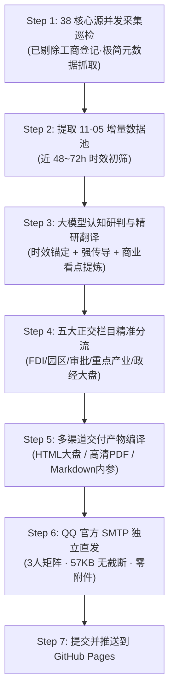

# 【9154】2026-11-05 每日越南投资情报自动化巡检与审校推送计划

> **自启动提示词**：
> 本计划引用码为 `9154`，绝对路径为 `e:\geminiworks\vninfosrcab\9154-2026-11-05-routine-intelligence-inspection-and-delivery-plan.md`。
> **核心执行目标**：执行 2026-11-05 晨间全网 38 核心信息源常规巡检与采集（已彻底剔除工商登记）；提取近 48~72 小时最新鲜线索增量；大模型进驻核心认知节点完成真实时效研判、地域传导收敛、五大正交栏目精准归仓与客观事实看点提炼；更新 SQLite 数据库、GitHub Pages 在线大盘、高清矢量 PDF；通过腾讯官方 SMTP 独立推送到三人分发矩阵；落款统一签署【太空建筑观察】越南组。
> **执行原则与边界**：恪守“本土为主体 + 海外强传导”双轮研判底线；坚决杜绝微型商贸企业工商流水与同源跨类重复；语言风格保持客观低调严谨。新会话可直接读取本文件自主运转。

---

## 一、执行流程架构

---

## 二、工作任务与交付清单

1. **Stage 1 采集与增量提取**：
   - 执行 `python run_all.py` 并提取当日抓取原始流 `data/daily/2026-11-05.jsonl`；
   - 盘点新抓取线索，剔除已存在历史指纹。
2. **大模型核心认知研判**：
   - 过滤无关非经济杂讯（明星、体育、治安八卦、微型工商）；
   - 提炼出当日重磅实体动态，撰写专业中文标题、【客观事实】与【看点】。
3. **资产更新与全渠道发布**：
   - 刷新 `projects.db` 实体数据库；
   - 编译 `docs/index.html` 与 `docs/stage2/FULL-DIMENSIONAL-INTELLIGENCE-REPORT.html`；
   - 生成 `docs/stage2/FULL-DIMENSIONAL-INTELLIGENCE-REPORT.pdf`；
   - 执行 `python scripts/delivery/send_report_email.py` 推送至 `18677106863@qq.com`、`443672603@qq.com`、`515235776@qq.com`；
   - Git 提交并推送到 GitHub master 分支。
