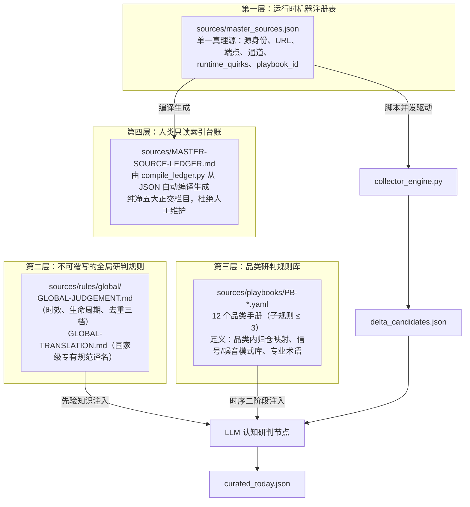

# 全量信源档案卡范式重构：GPT-6-Astra 与 Claude-Opus 双模型发包咨询综合审查报告 (Ref: 9381)

> **自启动提示词 (供新会话直接复制使用)**：  
> “本项目执行代号 **9381**，文档位于 `9381-2026-11-10-source-dossier-redesign-dual-model-consultation-report.md`。核心执行目标：依据 GPT-6-Astra（架构规划）与 Claude-Opus（独立审查）双云端大模型发包返回的权威评审结论，彻底废弃旧版‘196 个源独立撰写 Markdown 档案卡’的机械形式主义范式；落地‘机器资产注册表（JSON）+ 全局研判规则（Global Policy）+ 12 个品类认知操作手册（Playbooks）+ 自动编译总台账（Ledger）’的四层解耦资产体系；严格贯彻 196 源单射守恒、全局规则不可覆写、Prompt 事实抽槽优先于品类加载、事件生命周期状态机以及内容层时效锚定等核心纠偏原则。保持专业严谨、客观务实风格，直面核心技术矛盾，杜绝任何敷衍套话。”

---

## 一、 执行概要与审查背景

### 1.1 历史教训与重构动因
在项目早期（Ref: 4729），曾规划为全网 196 个信息源逐一建立独立的“活体档案卡”（位于 `sources/dossiers/`）。在首批 16 个国家级源落地后，深度复盘暴露出以下系统性硬伤：
1. **严重的机器信息重叠**：卡片大段复制 `master_sources.json` 中的 URL、状态码、响应耗时等采集元数据，形成双重维护与脱节；
2. **时效样本天生速朽**：卡片嵌入带具体日期的“最新实访样本”，一周内即过期归档，无法作为长期存续资产；
3. **诱导形式主义与模板复读**：单卡要求对样本撰写看点，实际执行中出现了大段复制粘贴同一句空洞套话（“该条情报直接反映国家主管机构最新法治或经济调节动向…”），完全丧失产业分析价值；
4. **同质化源的无效劳动**：16 省市 × 5 职能厅局 = 80 个地方政务源逻辑高度同质，为每一个源写长篇卡片属于无效消耗；
5. **未能针对性赋能下游**：下游 LLM 认知节点最需要的“栏目归仓指令、信号与噪音词典、专有译名规范”，在旧卡片中完全被泛化叙述淹没。

### 1.2 双模型闭环发包咨询机制
为探求底层资产建设的最优工程解，项目通过 `cllm02` 自动化发包驱动，先后向云端两大顶尖模型执行了两次正交咨询：
- **一审（架构规划与第一性原理）**：调度 **GPT-6-Astra**（Type A 架构方案类），从信息论、认知负荷与自动化情报系统长效运转视角，对“三层解耦重构方案”进行第一性原理推演；
- **二审（红蓝对抗与独立风险审查）**：调度 **Claude-Opus**（Type D 审查验收类），将原始提案与 Astra 一审意见合并输入，进行反向挑错、边界排查与落地工程化收口。

两份原始返回成果已分别持久化落盘至：
- Astra 返回原件：[`scratch/reply_astra_dossier_review.md`](file:///C:/Users/yy170/.gemini/antigravity/brain/0f21d42e-6e97-4bb8-8101-529736d3de35/scratch/reply_astra_dossier_review.md)
- Opus 返回原件：[`scratch/reply_opus_dossier_review.md`](file:///C:/Users/yy170/.gemini/antigravity/brain/0f21d42e-6e97-4bb8-8101-529736d3de35/scratch/reply_opus_dossier_review.md)

---

## 二、 GPT-6-Astra 一审方案的核心论点与裁决

Astra 给出的核心裁决为：**“批准三层解耦方向，但否决粗糙直迁。它减少的不是文档数量本身，而是同一规则被重复维护、却仍无法指导判断的成本。”**

Astra 提出的五大核心突破点：

### 2.1 资产真理源（Single Source of Truth）严格分工
Astra 明确提出三项资产的权责边界，杜绝“同一信息在三处记录”：
- **`master_sources.json`**：负责源身份、URL、采集通道与端点、主 Playbook ID、结构化例外（`runtime_quirks`）。**严禁负责逐条新闻样本与长篇分析**；
- **品类 Playbook**：负责可复用的业务研判规则、信号/噪音模式库与品类内差异。**严禁复制 JSON 字段与速朽动态**；
- **候选及事件库（DB）**：负责当次抓取内容、证据链、研判结果与复核状态。**严禁充当长期源档案**。
- **总台账（`MASTER-SOURCE-LEDGER.md`）**：由脚本根据 JSON 映射**全自动编译生成**，彻底消灭人工手工维护第三份映射的漂移反模式。

### 2.2 迁移前置红线：数量守恒对账（196 vs 206）
Astra 敏锐核查出任务书中列出的 12 类源数量相加为 **206**（16+7+12+10+8+18+6+16+17+48+13+35），与系统宣称的 196 源存在 **10 项偏差**。
- **执行要求**：必须在迁移前以稳定的 `source_id` 进行全量对账，确保 196 个有效源**各自有且仅有一个主 Playbook 归属**，杜绝多重归属或漏列。

### 2.3 分类颗粒度纠偏与“职能子规则”
- **PB-10（48 个地方三厅）**：保留 PB-10 一级类目，但决不能共用一套细则。财政、资源环境、建设三厅的高价值文件性质完全不同，必须分设 `FIN`（财政）、`ENV`（环境与土地）、`CON`（建设）三套职能子规则；
- **PB-12（35 个协会与通稿）**：必须区分“行业数据/统计”、“机构原始文件”与“企业公关通稿”。明确**企业通稿被多家媒体转载只算一个证据起点，不可作为独立交叉验证**；
- **信源品类与内容栏目解耦铁律**：Playbook 由信源决定，但五大报告栏目必须由“内容的新事实”决定。地方报报道外资设厂，必须归入 FDI，绝不能按地方媒体属性丢进综合动态。

### 2.4 抽取公共《全局研判规则》（Global Policy）
不要在 12 个 Playbook 内部把通用研判规则抄写 12 遍。必须设立独立的全局研判规则库，重点规范：
- **时效绝对锚定**：明确“HTTP 200 仅代表访问成功，不代表内容新鲜”；严格区分发布日、发生日、生效日与征询截止日；
- **事件生命周期状态机**：严格区分“拟投资 → 获投资登记证（IRC） → 完成审批 → 实际到资 → 投产”；
- **事实与看点严格分离**：【事实】只能陈述原文可追溯公文与数据，【看点】解释产业传导效应。

### 2.5 建立“黄金案例测试集（Golden Set）”替代速朽样本
彻底废除卡片内带日期的“最新样本栏”，改为建立永久固化的黄金边界案例集，标注预期栏目、裁量理由和反例，用于持续回归测试 LLM 研判提示词。

---

## 三、 Claude-Opus 独立审查意见与盲区挖掘

Claude-Opus 针对 Astra 一审方案进行了全面的红蓝对抗审查，既认可了 Astra 的关键突破，又对其潜在的“过度工程化冲动”进行了收口，更挖出了 **7 个一线并发运行中的系统性隐性盲区**。

### 3.1 对 Astra 一审意见的采纳与收口清单

| Astra 论点 | Opus 审查裁决 | Opus 补充的硬核工程约束 |
|---|:---:|---|
| **抽取《全局研判规则》** | **直接采纳 (P0)** | **“可引用不可覆写”铁律**：Playbook 只能引用全局规则编号，严禁各自重写时效规则，防止 6 个月后出现 12 份互相矛盾的副本。 |
| **PB-10 设 FIN/ENV/CON 子规则** | **采纳并卡死上限** | **子规则数严格 ≤ 3**；子规则只准定义模式库与词汇，不准另带流程，严禁颗粒度无限下钻。 |
| **总台账由 JSON 自动编译** | **直接采纳 (P0)** | **CI 三方一致性校验**：源数守恒、每条源必有且仅有一条主品类归属。 |
| **Golden Set 替代速朽样本** | **采纳并收口成本** | **总量硬上限 40~60 条**（每品类 3~5 条）；单命题测试；断言使用结构化字段（栏目、阶段）而非自由文本比对。 |
| **196 源一对一对账** | **直接采纳 (P0 前置)** | 解决 206≠196 守恒问题。 |
| **runtime_quirks 归采集层** | **完全认可** | A09 的 IIS TLS 等问题属于脚本网络层配置，绝非 LLM 认知。 |

### 3.2 Opus 挖掘出的三大致命系统性盲区（Astra 未覆盖）

#### 盲区 1：LLM 归仓的“信源品类 → 栏目”倒推污染（高危）
- **现象**：当 Playbook 是按品类组织时，模型在长上下文里极易形成思维定势——看到“该线索来自 PB-10（三厅）”，就顺手将其归入综合或行政公示，导致即使新闻内容是重磅外资设厂，也被误归仓。
- **Opus 破局方案**：**研判节点的 Prompt 执行时序必须彻底重排**：
  ```text
  【传统错误时序】：载入信源 Playbook → 阅读内容 → 决定栏目（产生先入为主污染）
  【Opus 纠偏时序】：先做内容事实抽槽（主体、动作、阶段、金额、地点） 
                   → 映射五大正交栏目 
                   → 最后载入对应 Playbook 做信号过滤与专业术语翻译
  ```

#### 盲区 2：事件生命周期的状态机无人负责（高危）
- **现象**：单篇新闻研判中，模型只能看到当前输入的一条线索，无法获知历史上下文。如果某项目半年前已获批，今天报道开工，模型缺乏参照系，极易产生“阶段倒退”或“重复报喜”。
- **Opus 破局方案**：流水线必须新增一层轻量的**事件状态台账（`event_ledger.py`）**，以 `event_key = 企业名 + 地点 + 项目名归一化` 为主键，记录项目已达到的最高生命周期阶段，研判时注入上下文进行校验与拦截。

#### 盲区 3：活链探活（HTTP 200）与内容时效的假象陷阱（中高危）
- **现象**：越南地方政务网站大量存在“页面常青、内容嵌 PDF”的情况。HTTP 200 永远是通的，但抓出来的可能是 2 年前的旧公文，导致旧闻反复诈尸入库。
- **Opus 破局方案**：时效锚定必须下沉到**内容层证据**（页面内日期字段、公文文号年份）。凡“探活通过但内容层无可靠日期”的条目，一律走 `date_unverified` 降级隔离，绝不参与今日增量排序！

#### 其他次级盲区提示：
- **去重三档语义清晰化**：同文转载（必须去重） vs 同事件不同侧面（不可去重） vs 同事件不同阶段（不可去重）；
- **静默失败可观测性**：为 196 源建立采集健康度基线（30天平均产出），偏离时在日报附注中告警，防范系统慢性失明；
- **事实与看点 schema 强校验**：【事实】挂原文片段锚点，【看点】声明依据的事实编号，无锚点的看点直接在校验层丢弃。

---

## 四、 确立的新架构终局模型：信源四层解耦资产体系

综合 Astra 与 Opus 审议结论，越南产业情报监测系统底层信源资产确立为以下四层架构：



### 4.1 目录结构标准规范
```text
sources/
├── master_sources.json          # 机器唯一资产注册表 (包含 196 源采集与规则绑定)
├── MASTER-SOURCE-LEDGER.md      # 自动编译生成的全局呈现台账 (只读)
├── rules/
│   └── global/
│       ├── GLOBAL-JUDGEMENT.md  # 全局研判规则 (时效锚定、生命周期状态机、去重三档)
│       └── GLOBAL-TRANSLATION.md# 全局翻译与实体命名规范
├── playbooks/                   # 12 个品类认知操作手册 (YAML/Markdown 规则规约)
│   ├── PB-01-national-regulatory.yaml
│   ├── PB-02-benchmark-parks.yaml
│   ├── PB-03-vn-general-media.yaml
│   ├── PB-04-vn-finance-media.yaml
│   ├── PB-05-vn-local-media.yaml
│   ├── PB-06-intl-media.yaml
│   ├── PB-07-industry-specialized.yaml
│   ├── PB-08-provincial-portal.yaml
│   ├── PB-09-provincial-iza.yaml
│   ├── PB-10-provincial-dept.yaml    # 内含 FIN / ENV / CON 三套职能子规则
│   ├── PB-11-enterprise-disclosure.yaml
│   └── PB-12-supplementary.yaml      # 内含 统计/公文/通稿 三套子规则
├── tests/
│   └── golden_set.json          # 固化的 40~60 条单命题结构化断言测试集
└── scripts/
    ├── compile_ledger.py        # 从 JSON 自动编译台账工具
    └── verify_consistency.py    # CI 三方一致性与源数守恒校验工具
```

---

## 五、 实施路线图与优先级规划

### Phase 0: 核心对账与底层解耦（P0 阶段，立即执行）
1. **196 源精确对账**：消除 206/196 的数量矛盾，为 `master_sources.json` 中每一个源配置唯一且合法的 `playbook_id`；
2. **台账编译脚本落地**：编写 `sources/scripts/compile_ledger.py`，从 JSON 自动编译生成规范纯净的 `MASTER-SOURCE-LEDGER.md`；
3. **全局规则制定**：建立 `sources/rules/global/GLOBAL-JUDGEMENT.md`（明确时效锚定、状态机、去重三档）；
4. **研判时序调整**：优化 LLM 研判提示词结构，确保“内容事实抽槽”先行于“Playbook 规则匹配”，消除归仓倒推污染。

### Phase 1: 规则库建设与测试集建立（P1 阶段，两周内）
1. **建立 12 个 Playbook 规则文件**，重点编写 `PB-01`、`PB-09`、`PB-10`（三厅子规则）与 `PB-11`（信披）；
2. **建设 40 条结构化 Golden Set**，确立测试断言；
3. **旧档案卡归档**：将 `sources/dossiers/` 中的旧卡片移入 `archive/legacy_dossiers/`。

### Phase 2: 流水线增强与防污染加固（P2 阶段）
1. **事件状态台账**：实现 `event_ledger.py`，支持跨周期项目阶段判定；
2. **时效下沉**：探活机制增加内文日期与文号年份提取，对无日期条目执行 `date_unverified` 降级；
3. **采集健康度基线**：监控 196 源每日产出基线，防止反爬导致的静默失明。

---

## 六、 结论与交接指引

通过引入 GPT-6-Astra 与 Claude-Opus 进行双向发包审议，本项目不仅彻底破除了“196 个源各写一篇空洞卡片”的形式主义旧范式，而且在架构层面完成了从**“散文式文档”到“工程规约化资产”**的跃升。

本报告已全面冻结决策结论。后续任何会话可直接复制文首自启动提示词，依循 Phase 0 路线图全面推展落地。
