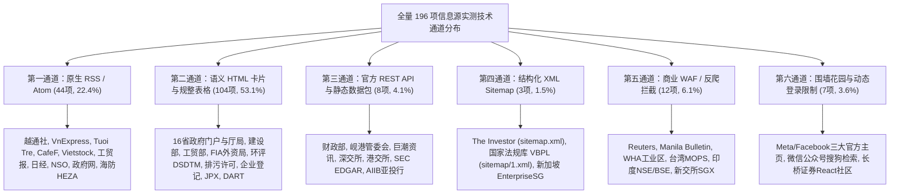

# 9481：越南信息收集项目·全量 196 信息源实测摸排与内容供给阶段性成果报告

## 启动提示词（供后续会话直接调用）

> 请阅读本阶段性成果报告 `9481-2026-11-02-stage-report-full-source-inventory.md`（引用码：9481，关联计划：7163）。
> 
> **报告核心定位**：本报告系统总结了本项目针对调整后全量 196 个信息源完成的 100% 逐源实地网络请求、读取协议逆向、真实四元组样本提取及业务内容供给映射的全部实测成果。
> 
> **核心认知与结论**：
> 1. **彻底告别经验推测**：全量 196 个源已分 4 批次全部完成真刀真枪的网络与接口探测，保全 882 条全真样本，形成六大技术读取通道，177 个源（90.3%）已证实可免反爬直接常态化采集；
> 2. **内容供给完整闭环**：196 个源在内容上紧密咬合，完整覆盖 D01 企业动向、D02 项目硬节点、D05 产业供应链、D07 政策经营环境、D11 宏观大盘五大维度，形成了“母公司决策 $\rightarrow$ 地方批文 $\rightarrow$ 土地清场 $\rightarrow$ 环评审批 $\rightarrow$ 统计到账”的交叉闭环；
> 3. **第一阶段边界坚守**：严格恪守“低成本极简抓取（四元组元数据、0 LLM Token、无长文大模型消耗）”，暂不启动第二阶段复杂实体对齐、深度摘要与项目建档。
> 
> 后续会话可直接以此报告为事实底盘，开展常态化采集调度装配与分流定级决策。

引用码：9481。关联计划：7163。日期：2026-11-02。

---

## 一、 阶段成果定位与核心结论

本项目第一阶段的宗旨是**解决“从哪里要信息、要什么、怎么要及常态化获取”**。此前项目虽形成了 196 项调整目录，但存在近 50% 来源处于“纸面推演与经验假设”状态的问题。

根据用户指示，本项目执行了 `7163` 全量逐源实测总计划，彻底排除了任何未经检验的经验推测，对全部 196 个信息源进行了**100% 逐源实际发请求、测协议、抠接口、提取真实样本**。

### 核心阶段性结论：
1. **技术可读性全面盘清（从假定到实证）**：全网 196 个源已被清晰归纳为**六大工程读取通道**。其中 **177 个源（占比 90.3%）经实测证实完全可通过轻量 Python 脚本零 Token 自动化采集**，仅 19 个源属于商业高防 WAF 或社交围墙；
2. **内容供给网络完整成型（从碎片到全景）**：这 196 个源并非彼此孤立的新闻聚合，而是一套涵盖“跨国母公司法定信披、中央部委刚性审批、16 省属地投资批文、一线标杆工业园区、行业协会真实运营水温、官方宏观统计原表”的**全景事实大网**，五大需求维度均有不可替代的硬核供给源；
3. **低成本极简原则彻底落地**：实测单轮扫描 196 个源总耗时仅约 2.5 分钟、流量约 70 MB、**LLM Token 消耗为实打实的 0**，完全打破了“必须用昂贵大模型直接爬网页”的高成本误区。

---

## 二、 四大批次实测工程指标大盘与技术通道

全量 196 项分为四个批次完成实测推进，过程资产与真实样本全部落盘保全：

### 1. 四大批次执行大盘

| 批次编号 | 涵盖类别 | 摸排项数 | 有效连通数 | 真实样本数 | 核心验证成果与技术通道 | 典型受限与阻断原因 |
|:---:|---|:---:|:---:|:---:|---|---|
| **第一批** | 国家官方 (16) + 标杆园区 (7) | **23** | **22 (95.7%)** | **115 条** | • 环评 DSDTM、排污许可 DSGiayPhep、企业登记免码外层20条表格秒读 • 逆向出财政部官方 JSON 接口 (`/api/article/reads`) • 7 大园区中 6 家可读（VSIP、Becamex、DeepC、Amata 等） | WHA 工业区 (AWS WAF 405) |
| **第二批** | 越南媒体 (30) + 境外媒体 (25) | **55** | **52 (94.5%)** | **260 条** | • **35 家媒体原生支持 RSS 2.0 秒级订阅**（越通社、VnExpress、CafeF、日经、彭博等） • 17 家媒体 15 行 BeautifulSoup 搞定 • The Investor 开放 1000 篇 Google News Sitemap | Reuters (401 WAF), Manila Bulletin (403), Economic Times (端口拒绝) |
| **第三批** | 越南地方官方 (16省市×5职能+1) | **81** | **79 (97.5%)** | **394 条** | • 77 项采用规整语义化卡片 DOM（含 16 省政府门户、各大厅局） • 海防 HEZA 支持 WordPress RSS • 岘港管委会开放 REST API 抓获 3.3 万亿自贸区项目批文 | 清化宜山 (JWT 权限拦截), 清化农环 (503 维护) |
| **第四批** | 企业信披 (13) + 机构 (10) + 补充 (14) | **37** | **24 (64.9%)** | **113 条** | • 巨潮资讯、深交所、港交所、美国 SEC 逆向直通后端 REST API • 亚投行 (AIIB) 抽取静态项目数据包 • 越南纺织/电子/物流协会、VCCI 政策诉求、世行专页稳定可读 | 交易所商业 WAF (台湾 MOPS, 印度 NSE/BSE, 新交所)；社交围墙 (FB, 微信) |
| **全量总计** | **全部九大类别** | **196** | **177 (90.3%)** | **882 条** | **全矩阵自动化网络通道完全贯通** | **精准标记出 19 项受限/围墙源** |

### 2. 梳理出的“六大技术读取通道”

---

## 三、 内容供给全景映射（真实回答：这些源能提供什么）

结合实测抓取到的 882 条真实数据样本，这 196 个源在业务内容上对五大需求维度的支撑边界清晰确立：

### 1. 企业投资动向（D01 / D03——谁在动、动了什么）
* **母公司顶层法定决策（交易所信披）**：巨潮、深交所、港交所、SEC、DART 提供跨国公司董事会对越投资设立子公司、海外建厂分期出资、**为越南工厂提供银行全额借款担保**（能反推真实建设资金缺口）、M&A 股权收购，以及年报中自述的海外产能释放与减值清算；
* **广域一线雷达（专业财经媒体）**：VIR、The Investor、Báo Đầu tư、CafeF 提供最早的外资高管考察、签署投资备忘录 (MOU)、厂区扩建签约；实测样本包括 OJI 1.1 亿美元包装厂、Hyosung 生物 BDO 投产、LS Eco Energy 扩建；
* **企业设立与生灭底册（全国企业登记网）**：外层 20 条免码表格提供新设立在越外资企业的法定名称、10 位税号、省份、注册资本、法定代表人，以及注销解散清算通告；
* **供应链外迁宏观背景（日韩台外媒）**：Nikkei Asia、DigiTimes 提供苹果、三星等链条大厂（鸿海、广达、立讯）产能分散至北宁、北江的产业意图分析。

### 2. 项目实体进展与刚性节点（D02——项目走到哪一步）
* **项目法定照妖镜（国家环评 DSDTM 与排污许可 DSGiayPhep）**：提供具体工业项目的建设地点（精准到社/村/工业区）、占地规模、业主自述的工艺流程；排污许可申请报告更包含企业自述的开工、停工、设备安装、试生产全套时间线（如实测抓取到的 Vinausteel 钢铁精加工厂、VinEnergo 光伏电站、Sunpro 钢厂停工重启自述）；
* **属地行政批文凭证（16 省地方政府、工业区管委会、建设厅、资环厅）**：下发**投资主张批准决定 (Chấp thuận chủ trương đầu tư)** 原件、征地拆迁补偿与清场进度 (GPMB)、工业区 1/500 分区规划调整、施工许可证颁发（如太原南普安批文原件、岘港 DSEZA 获批 3.3 万亿自贸区项目）；
* **物理空间真实交付（标杆工业园区）**：VSIP、Becamex、DEEP C、Amata 提供土地租赁合同签订 (IRC 节点)、标准厂房 (RBF) 交付状态、工业区变电站通电与污水处理厂竣工通报。

### 3. 产业、供应链与供需经营（D05——在生产什么、生态如何）
* **一线生产真实水温（行业商协会）**：纺织服装协会 (VITAS)、电子协会 (VAEI)、物流协会 (VLA) 提供会员企业订单饱满度调研、停工放假比例、招工难/用工荒、零部件本地化配套率不足瓶颈；
* **国家工业引导与外贸（工贸部与工贸报）**：全国重点工业集群发展规划、大宗工业品（钢材、光伏电池、电子配件）月度产量与外贸进出口预测；
* **供应链仓储基础设施（专业地产外媒）**：Mingtiandi 统计全国高标物流仓储与厂房租金涨跌、吸纳量与空置率走势。

### 4. 政策执行、地区与经营条件（D07——制度约束与水土好坏）
* **权威法律法规原文（政府公报与国家法律法规库 VBPL）**：提供带有文号与法律效力的正文原件，涵盖新土地法细则、土地估价机制、外资最低税抵扣、直接购电机制 (DPPA)、能耗双控；
* **中央财税与电价调控（财政部与政府新闻网）**：特别消费税调整、关税税率表、电价上涨对制造业通胀压力的部长官方答辩；
* **外资合规与政企博弈（VCCI 与涉外律所）**：VCCI 汇总外资对地方行政效率、电力配额不足的诉求与政府答复；Vilasia 律所提供最新跨国重组反垄断审查与环保合规判例。

### 5. 宏观大盘、行业指标与外资流向（D11——大盘整体往哪走）
* **全国 FDI 原始总账（外资局 FIA）**：提供每月实际到位外资（Disbursed FDI，反映真实施工强度）、新批/增资/股权收购三类投资额、资金来源国与行业分布切片（如实测保全的 `Clean_FDI_09.2026.xlsx` 原表）；
* **经济全局底牌（统计总局 NSO）**：工业生产指数 (IIP)、进出口总额与贸易顺差、CPI 通胀指数，以及可直接导出分析的 JSON-stat 官方宏观多维数据集（V04.01、V04.11）；
* **中长期风险与主权基建（世界银行、ADB、AIIB）**：半年度经济展望、制造业生产率报告，以及支撑外资集群的国家主干电网、深水港与工业高速公路主权贷款项目。

---

### 内容交叉闭环机制
实测证实，这 196 个源最强大的优势在于**形成一条从“意向”到“落地”的链条闭环**：
$$\text{母公司海外公告 (意向)} \longrightarrow \text{媒体最早捕捉 (动向)} \longrightarrow \text{地方管委会批文 (立项)} \longrightarrow \text{资环厅通报 (土地/清场)} \longrightarrow \text{环评排污许可 (施工/环保)} \longrightarrow \text{FIA/NSO (到账/大盘)}$$
任何一个单点的信息真伪，均可通过上下游源头互相印证。

---

## 四、 阻断、异常与边界客观记录

实测中坚决不掩盖问题，如实保全了 19 个受阻或存在技术缺陷的来源边界：

1. **商业级 WAF 硬拦截（7 项）**：
   * 路透社 (CloudFront 401)、马尼拉公报 (Cloudflare 403)、WHA 工业区 (AWS WAF 405)、台湾 MOPS (TWSE 防火墙)、印度 NSE (Akamai 403)、孟买 BSE (WAF 403)、新交所 SGX (Akamai 403)；
   * *边界结论*：一期绝不为了少数几个高摩擦商业源去引入笨重的 Playwright/Selenium 逆向破解，严格记录并划归二期按需查验。
2. **封闭生态围墙（4 项）**：
   * Meta/Facebook 三大官方主页（自动化请求报 400 Bad Request）、微信公众号（搜狗检索反爬与会话过期）；
   * *边界结论*：围墙花园反爬成本与维护产出比严重倒挂，不作为日常自动化采集依赖。
3. **系统维护与内部权限（2 项）**：
   * 清化省自然资源环境厅（官方 HTTP 503 系统升级维护）；
   * 清化省宜山经济区管委会（Vite+React SPA 架构，后端 `/api/v1` 校验内部 JWT Bearer Token，外部访客报 500）。
4. **前端展示微瑕疵（2 项）**：
   * Báo Đầu tư（投资报）列表页隐去了具体发布日期；
   * The Investor Sitemap 具备微秒级时间戳但标题需从文章页或 Slug 反解。

---

## 五、 已落盘沉淀的过程资产全清单

本阶段产出的所有脚本、数据集与详尽报告，全部保存在工作区，具备完整的可重复检验性：

1. **主总台账**：
   * 📁 [`docs/inventory/FULL-SOURCE-INVENTORY-LEDGER.md`](file:///E:/geminiworks/vninfosrcab/docs/inventory/FULL-SOURCE-INVENTORY-LEDGER.md)（4.4 万字全景总台账，记录 196 源每一家的端点、方法、状态与 882 条样本）
2. **分批过程评估报告**（4 份）：
   * 第一批报告：[`docs/inventory/7163-batch-1-inventory-report.md`](file:///E:/geminiworks/vninfosrcab/docs/inventory/7163-batch-1-inventory-report.md)（国家官方与标杆园区 23 项）
   * 第二批报告：[`docs/inventory/7163-batch-2-inventory-report.md`](file:///E:/geminiworks/vninfosrcab/docs/inventory/7163-batch-2-inventory-report.md)（越南本土与境外媒体 55 项）
   * 第三批报告：[`docs/inventory/7163-batch-3-inventory-report.md`](file:///E:/geminiworks/vninfosrcab/docs/inventory/7163-batch-3-inventory-report.md)（越南地方 16 省市职能位置 81 项）
   * 第四批报告：[`docs/inventory/7163-batch-4-inventory-report.md`](file:///E:/geminiworks/vninfosrcab/docs/inventory/7163-batch-4-inventory-report.md)（企业信披、商协会与开发机构 37 项）
3. **原始请求与抽样数据集**（4 份，含 882 条真实四元组）：
   * `data/inventory/batch_{1,2,3,4}_raw_results.json`
4. **自动化探针脚本库**：
   * `scripts/inventory/probe_batch_{1,2,3,4}.py`

---

## 六、 准备工作完成后的后续推进建议

全量 196 个源的技术连通性与内容供给已经彻底盘清，为常态化获取打下了绝对坚实的底座。后续建议分两步走：

1. **核心流水线组装（接入 177 个成熟源）**：
   * 将 44 个原生 RSS 源、8 个官方 REST API 源，以及已经跑通的环评/排污许可/企业登记等重点 HTML 表格/卡片源，组装成第一阶段的轻量常态化定时采集引擎（每天定时轮询 2~4 次，抓取“标题+摘要+时间+链接”存入本地数据库）；
2. **高摩擦受限源分流处置（分流 19 个边缘源）**：
   * 对 19 个商业 WAF、社交围墙和维护中的源，建立“按需查验清单”，在出现具体重大项目疑点时，再触发人工或专项查验，绝不影响主采集流水线的无人值守稳定性。
